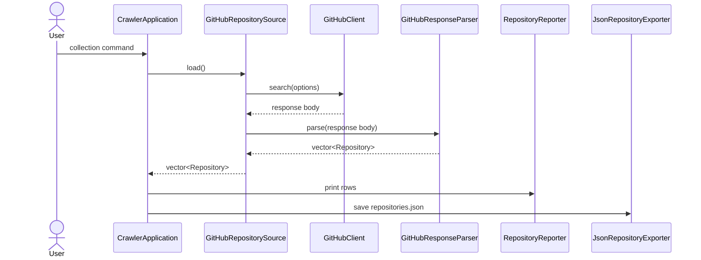
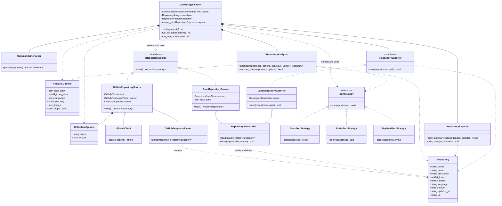
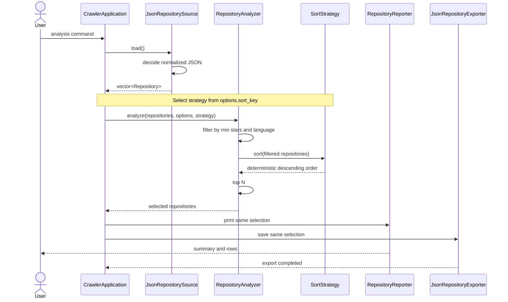

# GitHub Project Crawler System Design

> Working outline for Milestone 3. Replace every `TODO` before submission. This document describes a proposed refactoring; it does not claim that the design has already been implemented.

## Ownership and Parallel Work

| Work area | Contributor | Sections |
| --- | --- | --- |
| Part 1 | Jameson Irwin | Overview, Requirements, Data Acquisition Design, Collection Interaction |
| Part 2 | Brock McDermott | Analysis Architecture, UML, Analysis Interaction, Strategy Pattern |
| Part 3 | Kevin Silver | Application/Output Design, Test Design, Traceability, Final Editing |

The requirement IDs and class/interface names below are fixed coordination points. Contributors may improve explanations and declarations, but should not rename or renumber shared items without agreement from the team.

## Overview

<!-- PART 1 - JAMESON
TODO: Write 2-3 paragraphs explaining:
- What the crawler currently does in collection and analysis modes.
- Why the current mix of free functions, namespaces, and main() coordination should be refactored.
- How the proposed OOP design separates acquisition, analysis, output, and orchestration.
-->

## 1. Requirements

The IDs in this table are the stable references used by the class design and test plan.

<!-- PART 1 - JAMESON
TODO: Refine each requirement into polished report language. Preserve IDs and observable behavior.
-->

| ID | Testable requirement |
| --- | --- |
| R1 | The command-line application shall select collection or analysis mode, apply documented defaults, and reject unknown or malformed options with a clear error and nonzero exit status. |
| R2 | In collection mode, the system shall request the configured number of public repositories from GitHub, using `GITHUB_TOKEN` when available, and shall report connection or API failures without producing a successful result. |
| R3 | The system shall represent each repository with owner, name, description, stars, forks, language, size, updated time, and URL, preserving empty description or language values safely. |
| R4 | A successful collection shall print every collected repository and save the same normalized repositories as a valid JSON array in `repositories.json`. |
| R5 | In analysis mode, the system shall load normalized repository values from a selected local JSON dataset and reject missing, malformed, non-array, or incorrectly typed input. |
| R6 | The system shall filter loaded repositories by an inclusive minimum-star threshold and an optional exact language value. |
| R7 | The system shall sort repositories in descending order by stars, forks, or updated time, using owner and repository name as deterministic ascending tie-breakers. |
| R8 | The system shall apply top-N after filtering and sorting, returning all matches when fewer than N remain and rejecting an invalid zero value. |
| R9 | The system shall print and export the exact same selected repositories in the same order, including all required metadata fields in the JSON output. |
| R10 | The system shall report file, parsing, network, API, and output errors clearly, return a nonzero status, and avoid presenting incomplete work as successful. |

### 1.1 Requirement Notes and Examples

<!-- PART 1 - JAMESON
TODO: Add concise examples for collection, analysis, and one failure case. Explain what evidence would prove each behavior without discussing class implementation.
-->

## 2. System Design

### 2.1 Shared Design Contract

The proposed classes use the following fixed boundaries:

| Class or interface | Responsibility | Primary requirements |
| --- | --- | --- |
| `Repository` | Value object containing normalized repository metadata. | R3 |
| `CollectionOptions` | Value object containing GitHub query and count. | R1, R2 |
| `AnalysisOptions` | Value object containing input path, filters, sort key, top N, and output path. | R1, R5-R9 |
| `CommandLineParser` | Creates a parsed collection or analysis command and validates option syntax. | R1, R8 |
| `IRepositorySource` | Abstract interface that supplies normalized `Repository` values. | R2, R3, R5 |
| `GitHubRepositorySource` | Uses `GitHubClient` and `GitHubResponseParser` to acquire repositories. | R2-R4, R10 |
| `JsonRepositorySource` | Uses `RepositoryJsonCodec` to load a local normalized dataset. | R3, R5, R10 |
| `GitHubClient` | Performs the HTTPS request and returns the response body or an error. | R2, R10 |
| `GitHubResponseParser` | Converts GitHub search-response JSON into normalized repositories. | R3, R10 |
| `RepositoryJsonCodec` | Reads and writes the normalized local repository JSON schema. | R3-R5, R9-R10 |
| `RepositoryAnalyzer` | Coordinates Filter -> Sort -> Top N over repository values. | R6-R8 |
| `SortStrategy` | Abstract sorting contract selected at runtime. | R7 |
| `StarsSortStrategy` | Sorts by stars with deterministic ties. | R7 |
| `ForksSortStrategy` | Sorts by forks with deterministic ties. | R7 |
| `UpdatedSortStrategy` | Sorts by updated time with deterministic ties. | R7 |
| `RepositoryReporter` | Prints run summaries and repository rows. | R4, R9 |
| `IRepositoryExporter` | Abstract contract for exporting a selected collection. | R9, R10 |
| `JsonRepositoryExporter` | Exports through `RepositoryJsonCodec`. | R9, R10 |
| `CrawlerApplication` | Coordinates the selected workflow through the other classes. | R1-R10 |

### 2.2 Representative Shared Interfaces

These declarations establish the boundaries used by all three contributors. They are representative design declarations, not implementation code for this milestone.

```cpp
class IRepositorySource {
public:
    virtual std::vector<Repository> load() = 0;
    virtual ~IRepositorySource() = default;
};

class GitHubRepositorySource final : public IRepositorySource {
public:
    GitHubRepositorySource(
        GitHubClient& client,
        GitHubResponseParser& parser,
        CollectionOptions options);

    std::vector<Repository> load() override;
};

class JsonRepositorySource final : public IRepositorySource {
public:
    JsonRepositorySource(
        RepositoryJsonCodec& codec,
        std::filesystem::path input_path);

    std::vector<Repository> load() override;
};

class SortStrategy {
public:
    virtual void sort(std::vector<Repository>& repositories) const = 0;
    virtual ~SortStrategy() = default;
};

class RepositoryAnalyzer {
public:
    std::vector<Repository> analyze(
        const std::vector<Repository>& repositories,
        const AnalysisOptions& options,
        const SortStrategy& sort_strategy) const;
};

class IRepositoryExporter {
public:
    virtual void save(
        const std::vector<Repository>& repositories,
        const std::filesystem::path& path) const = 0;
    virtual ~IRepositoryExporter() = default;
};
```

### 2.3 Data Acquisition Design

<!-- PART 1 - JAMESON
TODO:
1. Explain Repository, option values, CommandLineParser, and both source implementations.
2. Explain why GitHubResponseParser and RepositoryJsonCodec are separate schemas.
3. Describe important data members and main functions for each acquisition class.
4. Explain ownership: sources reference collaborators supplied by CrawlerApplication for one workflow.
5. Map each class explicitly to R1-R5 and R10.
-->

#### 2.3.1 Collection Interaction

<!-- PART 1 - JAMESON
TODO: Complete or refine this sequence. Keep the class names stable.
-->



### 2.4 Analysis Architecture

`RepositoryAnalyzer` is a stateless application service that transforms a loaded collection into the repositories selected by `AnalysisOptions`. It owns the required analysis sequence--Filter, Sort, then Top N--but it does not load files, print rows, or export JSON. Keeping output outside the analyzer allows the same selected vector to be passed to both `RepositoryReporter` and `IRepositoryExporter`, which supports R9 without duplicating analysis logic.

The analyzer first copies matching `Repository` values into a result vector. A repository matches when its star count is greater than or equal to `min_stars` and its language equals the requested language when a language was supplied. An empty language option means any language. The inclusive star comparison preserves repositories exactly on the requested threshold, as required by R6.

After filtering, the analyzer delegates ordering to the supplied `SortStrategy`. Each strategy sorts its primary value in descending order and uses owner followed by repository name in ascending order when primary values tie. The common strategy interface allows runtime selection without placing a sort-key conditional inside the analyzer. The analyzer then applies top N by resizing only when the result contains more than `top_n` entries. If fewer than N remain, all matches are returned; an empty input or zero matches returns an empty vector. Command-line validation rejects a zero `top_n` before analysis begins.

Neither `RepositoryAnalyzer` nor the concrete strategies require persistent data members. They are behavior objects: all input arrives through method parameters, and each call produces a result without retaining repositories between runs. This makes repeated calls independent and permits one strategy object to be reused safely.

Representative declarations are:

```cpp
class StarsSortStrategy final : public SortStrategy {
public:
    void sort(std::vector<Repository>& repositories) const override;
};

class ForksSortStrategy final : public SortStrategy {
public:
    void sort(std::vector<Repository>& repositories) const override;
};

class UpdatedSortStrategy final : public SortStrategy {
public:
    void sort(std::vector<Repository>& repositories) const override;
};

class RepositoryAnalyzer {
public:
    std::vector<Repository> analyze(
        const std::vector<Repository>& repositories,
        const AnalysisOptions& options,
        const SortStrategy& sort_strategy) const;

private:
    bool matches_filters(
        const Repository& repository,
        const AnalysisOptions& options) const;
};
```

`RepositoryAnalyzer::analyze()` accepts its input by const reference and returns a separate vector, so analysis does not reorder or truncate the loaded dataset. `SortStrategy::sort()` intentionally accepts the internal result vector by mutable reference because sorting is the strategy's sole responsibility. Updated timestamps use the same GitHub ISO 8601 format, so descending string comparison produces descending chronological order for this project.

| Requirement | Analysis design support |
| --- | --- |
| R6 | `matches_filters()` applies inclusive minimum stars and optional exact language matching. |
| R7 | The three `SortStrategy` implementations provide descending, deterministic runtime-selectable ordering. |
| R8 | `analyze()` performs top-N truncation only after filtering and sorting and retains all values when fewer than N remain. |

### 2.5 Class Structure and Relationships

Figure 1 shows the complete proposed class structure. Interface realization is used where behavior is expected to vary at runtime. Composition identifies services whose lifecycle is controlled by `CrawlerApplication`; aggregation identifies collaborators supplied to another object by reference. Dashed arrows show temporary usage of values or services during one workflow.



#### Relationship Explanation

`GitHubRepositorySource` and `JsonRepositorySource` realize `IRepositorySource`. The application can therefore acquire `vector<Repository>` values without coupling its workflow to HTTPS or file I/O. The same interface also permits a fake source to return controlled repositories during application tests. `StarsSortStrategy`, `ForksSortStrategy`, and `UpdatedSortStrategy` realize `SortStrategy`, so `RepositoryAnalyzer` invokes one sorting contract regardless of the selected key. `JsonRepositoryExporter` realizes `IRepositoryExporter`, which lets application tests replace disk output with an in-memory fake.

`CrawlerApplication` composes `CommandLineParser`, `RepositoryAnalyzer`, `RepositoryReporter`, and an `IRepositoryExporter` implementation because it coordinates their lifecycles as application services. It uses an `IRepositorySource` and `SortStrategy` selected for the current command, but those temporary workflow objects are not part of the application's domain state. The application depends on their abstract interfaces, following dependency inversion and allowing collection and analysis to share one controller.

`GitHubRepositorySource` aggregates `GitHubClient` and `GitHubResponseParser`: it delegates communication and GitHub-specific JSON conversion rather than implementing either responsibility. It contains a `CollectionOptions` value for the request being performed. `JsonRepositorySource` and `JsonRepositoryExporter` aggregate `RepositoryJsonCodec`, allowing both directions of the normalized dataset schema to remain in one component. These collaborators can be injected, reused, or replaced by test doubles without changing the source or exporter contracts.

Dashed dependencies indicate method-level use rather than ownership. `RepositoryAnalyzer` reads `AnalysisOptions`, copies `Repository` values, and calls a `SortStrategy`. Parsers and codecs create or serialize `Repository` values but do not own repositories after returning. `RepositoryReporter` and `IRepositoryExporter` receive selected values by const reference and cannot change the selection. The options and repository objects are value types, so their lifetimes are controlled by the workflow that created them.

Sources and exporters are interfaces because the system already has multiple acquisition mechanisms and because external I/O benefits from substitution in tests. Sorting is an interface because its algorithm varies by user selection. `RepositoryReporter` remains concrete because the required terminal representation has one stable behavior and no current runtime variation; introducing an interface for a single nonvarying format would add indirection without solving a design problem. This balance applies abstraction at actual variation points rather than creating interfaces for every class.

### 2.6 Analysis Interaction

Figure 2 traces one analysis command. `CrawlerApplication` first requests normalized values from `JsonRepositorySource`; GitHub collection is not part of this path. The application selects one concrete strategy from `AnalysisOptions.sort_key` and passes it to `RepositoryAnalyzer`. The analyzer owns the three ordered transformation steps and returns one selected vector. The application then passes that same const collection to both output components.



This interaction enforces the required order because the strategy is invoked only after filtering and top-N resizing occurs only after the strategy returns. `RepositoryReporter` and `JsonRepositoryExporter` never invoke `RepositoryAnalyzer` themselves, so neither can accidentally apply different filters or ordering. Both receive the exact vector returned by `analyze()`, preserving repository identity, order, and count for R9.

The source completes loading before analysis begins. If loading throws a missing-file, malformed-JSON, or schema error, control returns to `CrawlerApplication`, which reports failure and does not call the analyzer or output components. Similarly, an export failure is returned after reporting but is not described as a successful export. These boundaries support the error behavior in R10 while keeping error presentation in the application layer.

### 2.7 Application Coordination and Output Design

<!-- PART 3 - KEVIN
TODO:
1. Describe CrawlerApplication, RepositoryReporter, IRepositoryExporter, and JsonRepositoryExporter.
2. Show how collection and analysis enter separate private workflows.
3. Explain ownership and dependency injection for testability.
4. Explain how one selected vector is passed unchanged to reporter and exporter.
5. Map these classes to R1, R4, R9, and R10.
-->

## 3. Test Design

<!-- PART 3 - KEVIN
TODO: Replace/add rows as needed. Every test needs target, setup, and explicit expected result. These are planned tests, not claimed execution results.
-->

| Test | Target | Input / setup | Expected result |
| --- | --- | --- | --- |
| T1 | R1, `CommandLineParser` | Valid collection and analysis commands using defaults and explicit options. | Correct command/options are produced. |
| T2 | R1, R8 | Unknown option, missing value, invalid number, and top N of zero. | Input is rejected with a clear error. |
| T3 | R2-R4, collection workflow | Fake GitHub source returns known repository values. | Values are printed and saved without live network access. |
| T4 | R2, R10 | Fake client returns a connection or API failure. | Workflow returns failure and does not report success. |
| T5 | R3, `GitHubResponseParser` | Response containing normal and null description/language fields. | All metadata is normalized correctly; null text becomes empty. |
| T6 | R5, `JsonRepositorySource` | Valid normalized JSON fixture. | All repository values are loaded correctly. |
| T7 | R5, R10 | Missing, malformed, non-array, and wrong-type datasets. | Each input is rejected with a path-aware error. |
| T8 | R6, filtering | Threshold boundary, language match, combined filters, and zero matches. | Only repositories satisfying every active filter remain. |
| T9 | R7, sort strategies | Repositories with primary-key ties for each strategy. | Results are descending with owner/name tie-breakers. |
| T10 | R8, top N | N below, equal to, and above match count. | Exactly N or all remaining values are returned as required. |
| T11 | R9, reporter/exporter | One known selected vector is passed to both outputs. | Identity, order, count, and fields match exactly. |
| T12 | R9 | Empty selected vector. | No rows are printed and export is `[]`. |
| T13 | R9-R10 | Unwritable output path. | Export fails clearly and application returns nonzero. |
| T14 | R1-R10 | End-to-end tests using fake sources and temporary files. | Both workflows produce the expected deterministic outputs. |

### 3.1 Coverage and Evaluation Plan

<!-- PART 3 - KEVIN
TODO: Explain component vs integration tests, why fakes avoid live GitHub, and what evidence the final milestone will record.
-->

| Requirement | Planned tests |
| --- | --- |
| R1 | T1, T2, T14 |
| R2 | T3, T4, T14 |
| R3 | T3, T5, T6 |
| R4 | T3, T14 |
| R5 | T6, T7, T14 |
| R6 | T8, T14 |
| R7 | T9, T14 |
| R8 | T2, T10, T14 |
| R9 | T11, T12, T13, T14 |
| R10 | T2, T4, T7, T13, T14 |

## Optional Bonus: Strategy Pattern

### Design Problem

The analysis workflow is stable--Filter, Sort, then Top N--but the sorting algorithm varies at runtime. Stars, forks, and updated time use different primary fields while sharing descending order and deterministic owner/name tie-breaking. Placing a chain of sort-key conditionals and all comparator implementations inside `RepositoryAnalyzer` would give that class multiple reasons to change. Adding a new sort mode would require editing the analyzer's control flow even though filtering and top-N behavior remain unchanged.

### Selected Pattern and Participants

The proposed design applies the Strategy pattern to this variation point. `SortStrategy` defines the sorting contract, and `StarsSortStrategy`, `ForksSortStrategy`, and `UpdatedSortStrategy` encapsulate the concrete algorithms. `RepositoryAnalyzer` is the context: it receives a strategy through `analyze()` and delegates only the ordering step. `CrawlerApplication` is responsible for selecting the concrete strategy from the already validated `sort_key`.

```cpp
std::unique_ptr<SortStrategy> make_sort_strategy(std::string_view sort_key)
{
    if (sort_key == "stars") {
        return std::make_unique<StarsSortStrategy>();
    }
    if (sort_key == "forks") {
        return std::make_unique<ForksSortStrategy>();
    }
    if (sort_key == "updated") {
        return std::make_unique<UpdatedSortStrategy>();
    }
    throw std::invalid_argument("unsupported sort key");
}
```

The selection helper is shown to clarify object creation; the design-pattern benefit comes from polymorphic use after selection. Once created, the analyzer communicates only through `SortStrategy::sort()` and does not inspect the key or concrete type.

### Collaboration

For an analysis command, `CrawlerApplication` chooses one strategy and passes it by reference with the loaded repositories and `AnalysisOptions`. `RepositoryAnalyzer` filters into a working vector, invokes the strategy on that vector, then applies top N. The concrete strategy compares its primary field and applies the same owner/name tie-breaking rule. It returns control without printing, exporting, or changing the original loaded vector.

### Expected Improvement

Strategy keeps `RepositoryAnalyzer` focused on workflow order and supports the open/closed principle: a future sort mode can be added as another `SortStrategy` implementation without changing analyzer logic. Each strategy can be tested directly with ties and boundary data, while analyzer tests can use a fake strategy to verify delegation and Filter -> Sort -> Top N ordering. Runtime selection remains explicit, and the three current algorithms share one interface that is visible in the UML model.

The pattern introduces several small classes and one virtual call, but repository sorting already represents a real family of user-selectable algorithms. That variation and the need for isolated deterministic tests justify the additional abstraction. Applying Strategy to filtering or reporting would not currently provide the same benefit because those behaviors do not have multiple runtime-selectable implementations in the requirements.

## Final Review Checklist

- [ ] All TODO comments are resolved and removed.
- [ ] Requirement IDs remain R1-R10 throughout the report.
- [ ] Class names match in prose, declarations, and diagrams.
- [ ] Every class has responsibility, important state, and main interfaces explained.
- [ ] Every UML relationship is described in prose.
- [ ] Both workflows have complete interaction explanations.
- [ ] Every test has target, setup, and expected result.
- [ ] Every requirement maps to classes and planned tests.
- [ ] Strategy is justified as a meaningful variation point.
- [ ] The report does not claim proposed classes or tests are already implemented.
