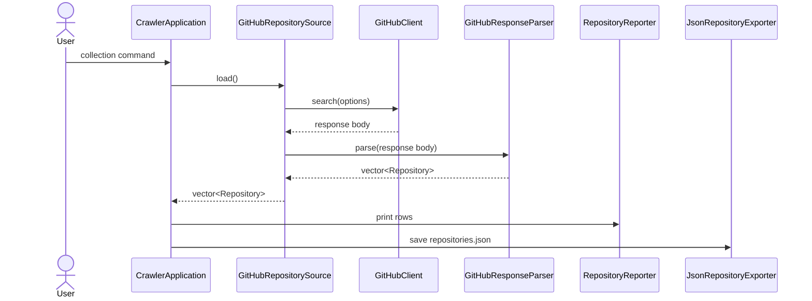
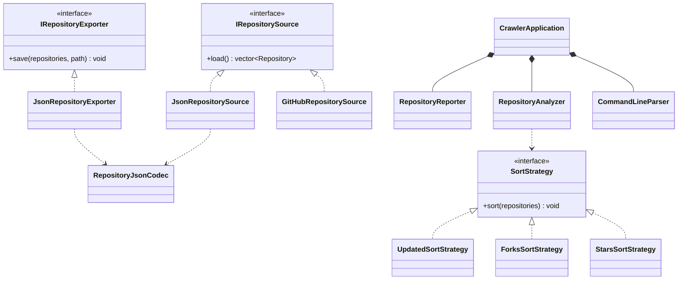
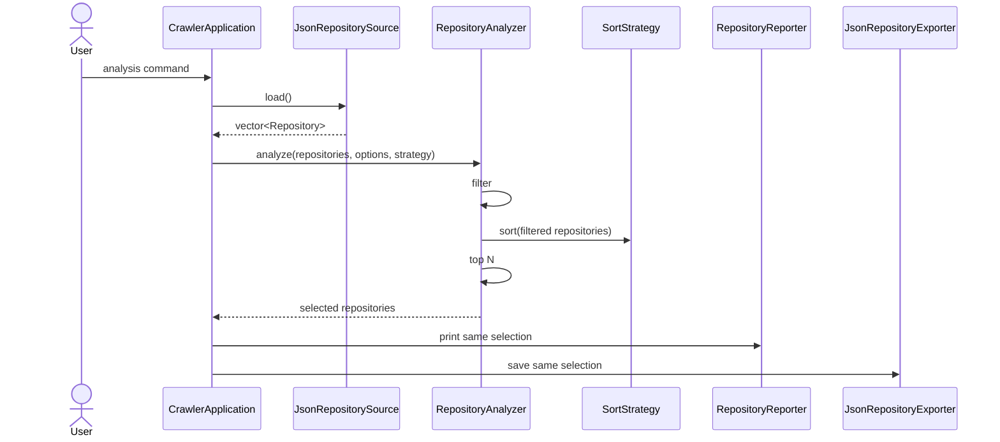

# GitHub Project Crawler System Design

> Working outline for Milestone 3. Replace every `TODO` before submission. This document describes a proposed refactoring; it does not claim that the design has already been implemented.

## Ownership and Parallel Work

| Work area | Contributor | Sections |
| --- | --- | --- |
| Part 1 | Jameson Irwin | Overview, Requirements, Data Acquisition Design, Collection Interaction |
| Part 2 | Brock McDermott | Analysis Architecture, UML, Analysis Interaction, Strategy Pattern |
| Part 3 | Kevin Silver | Application/Output Design, Test Design, Traceability, Final Editing |

The requirement IDs and class/interface names below are fixed coordination points. Contributors may improve explanations and declarations, but should not rename or renumber shared items without agreement from the team.

## Overview

<!-- PART 1 - JAMESON
TODO: Write 2-3 paragraphs explaining:
- What the crawler currently does in collection and analysis modes.
- Why the current mix of free functions, namespaces, and main() coordination should be refactored.
- How the proposed OOP design separates acquisition, analysis, output, and orchestration.
-->

## 1. Requirements

The IDs in this table are the stable references used by the class design and test plan.

<!-- PART 1 - JAMESON
TODO: Refine each requirement into polished report language. Preserve IDs and observable behavior.
-->

| ID | Testable requirement |
| --- | --- |
| R1 | The command-line application shall select collection or analysis mode, apply documented defaults, and reject unknown or malformed options with a clear error and nonzero exit status. |
| R2 | In collection mode, the system shall request the configured number of public repositories from GitHub, using `GITHUB_TOKEN` when available, and shall report connection or API failures without producing a successful result. |
| R3 | The system shall represent each repository with owner, name, description, stars, forks, language, size, updated time, and URL, preserving empty description or language values safely. |
| R4 | A successful collection shall print every collected repository and save the same normalized repositories as a valid JSON array in `repositories.json`. |
| R5 | In analysis mode, the system shall load normalized repository values from a selected local JSON dataset and reject missing, malformed, non-array, or incorrectly typed input. |
| R6 | The system shall filter loaded repositories by an inclusive minimum-star threshold and an optional exact language value. |
| R7 | The system shall sort repositories in descending order by stars, forks, or updated time, using owner and repository name as deterministic ascending tie-breakers. |
| R8 | The system shall apply top-N after filtering and sorting, returning all matches when fewer than N remain and rejecting an invalid zero value. |
| R9 | The system shall print and export the exact same selected repositories in the same order, including all required metadata fields in the JSON output. |
| R10 | The system shall report file, parsing, network, API, and output errors clearly, return a nonzero status, and avoid presenting incomplete work as successful. |

### 1.1 Requirement Notes and Examples

<!-- PART 1 - JAMESON
TODO: Add concise examples for collection, analysis, and one failure case. Explain what evidence would prove each behavior without discussing class implementation.
-->

## 2. System Design

### 2.1 Shared Design Contract

The proposed classes use the following fixed boundaries:

| Class or interface | Responsibility | Primary requirements |
| --- | --- | --- |
| `Repository` | Value object containing normalized repository metadata. | R3 |
| `CollectionOptions` | Value object containing GitHub query and count. | R1, R2 |
| `AnalysisOptions` | Value object containing input path, filters, sort key, top N, and output path. | R1, R5-R9 |
| `CommandLineParser` | Creates a parsed collection or analysis command and validates option syntax. | R1, R8 |
| `IRepositorySource` | Abstract interface that supplies normalized `Repository` values. | R2, R3, R5 |
| `GitHubRepositorySource` | Uses `GitHubClient` and `GitHubResponseParser` to acquire repositories. | R2-R4, R10 |
| `JsonRepositorySource` | Uses `RepositoryJsonCodec` to load a local normalized dataset. | R3, R5, R10 |
| `GitHubClient` | Performs the HTTPS request and returns the response body or an error. | R2, R10 |
| `GitHubResponseParser` | Converts GitHub search-response JSON into normalized repositories. | R3, R10 |
| `RepositoryJsonCodec` | Reads and writes the normalized local repository JSON schema. | R3-R5, R9-R10 |
| `RepositoryAnalyzer` | Coordinates Filter -> Sort -> Top N over repository values. | R6-R8 |
| `SortStrategy` | Abstract sorting contract selected at runtime. | R7 |
| `StarsSortStrategy` | Sorts by stars with deterministic ties. | R7 |
| `ForksSortStrategy` | Sorts by forks with deterministic ties. | R7 |
| `UpdatedSortStrategy` | Sorts by updated time with deterministic ties. | R7 |
| `RepositoryReporter` | Prints run summaries and repository rows. | R4, R9 |
| `IRepositoryExporter` | Abstract contract for exporting a selected collection. | R9, R10 |
| `JsonRepositoryExporter` | Exports through `RepositoryJsonCodec`. | R9, R10 |
| `CrawlerApplication` | Coordinates the selected workflow through the other classes. | R1-R10 |

### 2.2 Representative Shared Interfaces

These declarations establish the boundaries used by all three contributors. They are representative design declarations, not implementation code for this milestone.

```cpp
class IRepositorySource {
public:
    virtual std::vector<Repository> load() = 0;
    virtual ~IRepositorySource() = default;
};

class GitHubRepositorySource final : public IRepositorySource {
public:
    GitHubRepositorySource(
        GitHubClient& client,
        GitHubResponseParser& parser,
        CollectionOptions options);

    std::vector<Repository> load() override;
};

class JsonRepositorySource final : public IRepositorySource {
public:
    JsonRepositorySource(
        RepositoryJsonCodec& codec,
        std::filesystem::path input_path);

    std::vector<Repository> load() override;
};

class SortStrategy {
public:
    virtual void sort(std::vector<Repository>& repositories) const = 0;
    virtual ~SortStrategy() = default;
};

class RepositoryAnalyzer {
public:
    std::vector<Repository> analyze(
        const std::vector<Repository>& repositories,
        const AnalysisOptions& options,
        const SortStrategy& sort_strategy) const;
};

class IRepositoryExporter {
public:
    virtual void save(
        const std::vector<Repository>& repositories,
        const std::filesystem::path& path) const = 0;
    virtual ~IRepositoryExporter() = default;
};
```

### 2.3 Data Acquisition Design

<!-- PART 1 - JAMESON
TODO:
1. Explain Repository, option values, CommandLineParser, and both source implementations.
2. Explain why GitHubResponseParser and RepositoryJsonCodec are separate schemas.
3. Describe important data members and main functions for each acquisition class.
4. Explain ownership: sources reference collaborators supplied by CrawlerApplication for one workflow.
5. Map each class explicitly to R1-R5 and R10.
-->

#### 2.3.1 Collection Interaction

<!-- PART 1 - JAMESON
TODO: Complete or refine this sequence. Keep the class names stable.
-->



### 2.4 Analysis Architecture

<!-- PART 2 - BROCK
TODO:
1. Explain RepositoryAnalyzer and why it owns workflow order but not output.
2. Explain filter behavior and inclusive minimum-star/language rules.
3. Explain top-N behavior and edge cases.
4. Explain SortStrategy and all three concrete strategies.
5. Include representative declarations for StarsSortStrategy, ForksSortStrategy, and UpdatedSortStrategy.
6. Map the analysis classes explicitly to R6-R8.
-->

### 2.5 Class Structure and Relationships

<!-- PART 2 - BROCK
TODO: Complete the Mermaid class diagram using the fixed class names. Show:
- Inheritance from IRepositorySource, SortStrategy, and IRepositoryExporter.
- CrawlerApplication composition/ownership of parser, analyzer, reporter, and exporter dependencies.
- Usage of Repository and option value types.
- GitHubRepositorySource usage of client/parser.
- JsonRepositorySource and JsonRepositoryExporter usage of RepositoryJsonCodec.
Explain every arrow in prose after the diagram.
-->



#### Relationship Explanation

<!-- PART 2 - BROCK
TODO: Explain inheritance, composition, and usage relationships in the diagram. State why sources/exporters are abstractions while RepositoryReporter remains concrete.
-->

### 2.6 Analysis Interaction

<!-- PART 2 - BROCK
TODO: Refine this sequence and explain how it proves Filter -> Sort -> Top N and shared output selection.
-->



### 2.7 Application Coordination and Output Design

<!-- PART 3 - KEVIN
TODO:
1. Describe CrawlerApplication, RepositoryReporter, IRepositoryExporter, and JsonRepositoryExporter.
2. Show how collection and analysis enter separate private workflows.
3. Explain ownership and dependency injection for testability.
4. Explain how one selected vector is passed unchanged to reporter and exporter.
5. Map these classes to R1, R4, R9, and R10.
-->

## 3. Test Design

<!-- PART 3 - KEVIN
TODO: Replace/add rows as needed. Every test needs target, setup, and explicit expected result. These are planned tests, not claimed execution results.
-->

| Test | Target | Input / setup | Expected result |
| --- | --- | --- | --- |
| T1 | R1, `CommandLineParser` | Valid collection and analysis commands using defaults and explicit options. | Correct command/options are produced. |
| T2 | R1, R8 | Unknown option, missing value, invalid number, and top N of zero. | Input is rejected with a clear error. |
| T3 | R2-R4, collection workflow | Fake GitHub source returns known repository values. | Values are printed and saved without live network access. |
| T4 | R2, R10 | Fake client returns a connection or API failure. | Workflow returns failure and does not report success. |
| T5 | R3, `GitHubResponseParser` | Response containing normal and null description/language fields. | All metadata is normalized correctly; null text becomes empty. |
| T6 | R5, `JsonRepositorySource` | Valid normalized JSON fixture. | All repository values are loaded correctly. |
| T7 | R5, R10 | Missing, malformed, non-array, and wrong-type datasets. | Each input is rejected with a path-aware error. |
| T8 | R6, filtering | Threshold boundary, language match, combined filters, and zero matches. | Only repositories satisfying every active filter remain. |
| T9 | R7, sort strategies | Repositories with primary-key ties for each strategy. | Results are descending with owner/name tie-breakers. |
| T10 | R8, top N | N below, equal to, and above match count. | Exactly N or all remaining values are returned as required. |
| T11 | R9, reporter/exporter | One known selected vector is passed to both outputs. | Identity, order, count, and fields match exactly. |
| T12 | R9 | Empty selected vector. | No rows are printed and export is `[]`. |
| T13 | R9-R10 | Unwritable output path. | Export fails clearly and application returns nonzero. |
| T14 | R1-R10 | End-to-end tests using fake sources and temporary files. | Both workflows produce the expected deterministic outputs. |

### 3.1 Coverage and Evaluation Plan

<!-- PART 3 - KEVIN
TODO: Explain component vs integration tests, why fakes avoid live GitHub, and what evidence the final milestone will record.
-->

| Requirement | Planned tests |
| --- | --- |
| R1 | T1, T2, T14 |
| R2 | T3, T4, T14 |
| R3 | T3, T5, T6 |
| R4 | T3, T14 |
| R5 | T6, T7, T14 |
| R6 | T8, T14 |
| R7 | T9, T14 |
| R8 | T2, T10, T14 |
| R9 | T11, T12, T13, T14 |
| R10 | T2, T4, T7, T13, T14 |

## Optional Bonus: Strategy Pattern

<!-- PART 2 - BROCK
TODO: Write the bonus explanation with four explicit parts:
1. Problem: sort behavior varies while analysis workflow stays fixed.
2. Pattern: Strategy encapsulates each sorting algorithm behind one interface.
3. Participants: RepositoryAnalyzer, SortStrategy, and three concrete strategies.
4. Improvement: runtime selection, isolated tests, and extension without changing analyzer control flow.
Explain why a conditional inside RepositoryAnalyzer would be more tightly coupled.
-->

## Final Review Checklist

- [ ] All TODO comments are resolved and removed.
- [ ] Requirement IDs remain R1-R10 throughout the report.
- [ ] Class names match in prose, declarations, and diagrams.
- [ ] Every class has responsibility, important state, and main interfaces explained.
- [ ] Every UML relationship is described in prose.
- [ ] Both workflows have complete interaction explanations.
- [ ] Every test has target, setup, and expected result.
- [ ] Every requirement maps to classes and planned tests.
- [ ] Strategy is justified as a meaningful variation point.
- [ ] The report does not claim proposed classes or tests are already implemented.
