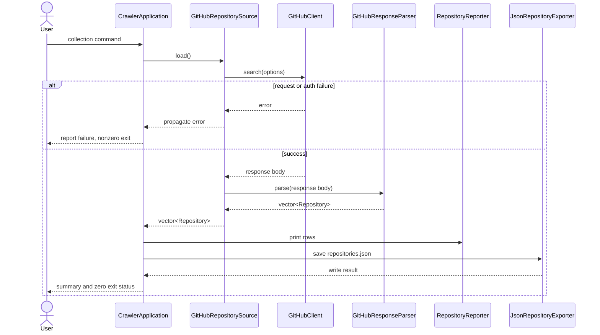
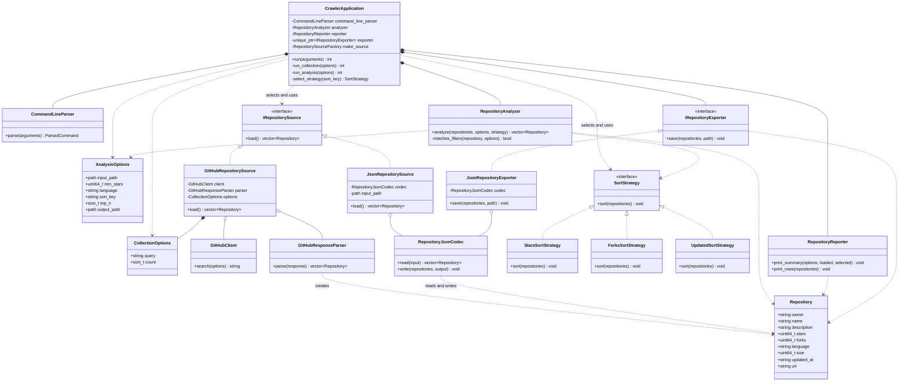
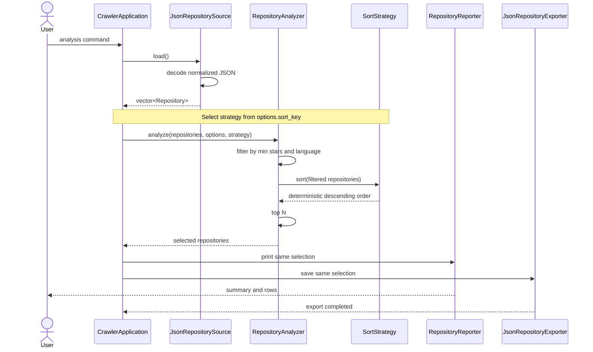
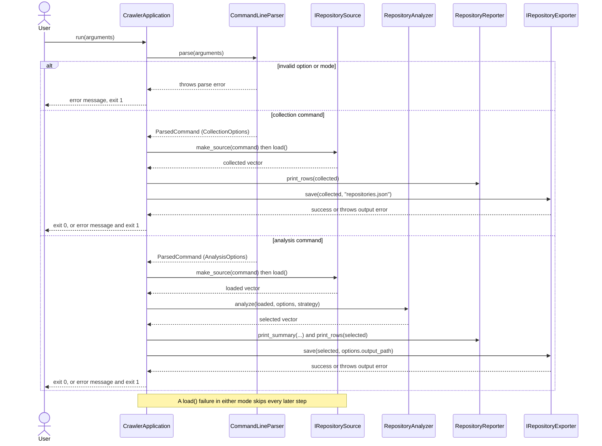

# GitHub Project Crawler System Design

This document proposes an object-oriented refactoring of the existing GitHub Project Crawler. It describes the planned design and tests; it does not claim that the refactoring has been implemented.

## Overview

The GitHub Project Crawler currently runs two modes out of one `main()`: collection mode builds a `SearchOptions` value, sends it through `GitHubClient` to GitHub's Search API, hands the response body to `RepositoryParser`, and uses `RepositoryStore` to print the results and save them to `repositories.json`. Analysis mode builds an `AnalysisOptions` value, loads a local JSON dataset through `DataLoader`, filters it with `repository_filter`, sorts and truncates it with `repository_analyzer`, and prints/exports the result through `Reporter` and `JsonExporter`. Both modes work, and the acceptance criteria for Milestones 1 and 2 are met, but the implementation is a collection of free functions and namespaces (`DataLoader::`, `RepositoryStore::`, `Reporter::`, `JsonExporter::`) coordinated directly inside `main()`.

That style creates three recurring problems. First, `main()` itself decides which mode to run, builds every collaborator, and calls each step directly, so the orchestration logic for an entire workflow lives in one function with no name of its own and no way to substitute a fake collaborator for testing. Second, the two workflows read and write JSON through two independently written code paths -- `RepositoryParser` for GitHub's response shape and `DataLoader`/`RepositoryStore` for the project's own local schema -- with no shared boundary enforcing that both paths agree on what a normalized `Repository` looks like. Third, because printing and saving are separate free-function calls rather than one consistently reused value, nothing currently guarantees that what gets printed and what gets exported are the same selection in the same order, which is exactly what R9 requires.

The proposed design replaces this with a small set of collaborating objects. `IRepositorySource` abstracts "produce normalized `Repository` values," so collection and analysis share one acquisition contract instead of two unrelated code paths. `RepositoryAnalyzer` isolates the filter/sort/top-N pipeline so it can be tested without touching acquisition or output at all. `RepositoryReporter` and `IRepositoryExporter` both receive the exact same selected vector from `CrawlerApplication`, so there is one selection used for both the printed and the exported view rather than two separate calls that could drift apart. `CrawlerApplication` becomes the one place that decides collection vs. analysis, constructs and wires the collaborators for that workflow, and reports failure -- replacing the orchestration that free functions in `main()` currently handle implicitly.

## 1. Requirements

The IDs in this table are the stable references used by the class design and test plan.

| ID | Testable requirement |
| --- | --- |
| R1 | The command-line application shall select collection or analysis mode (rejecting an unrecognized mode the same way as an unrecognized option), apply documented defaults, and reject unknown or malformed options with a clear error and nonzero exit status. |
| R2 | In collection mode, the system shall request the configured number of public repositories from GitHub, using `GITHUB_TOKEN` when available, and shall report connection or API failures without producing a successful result. |
| R3 | The system shall represent each repository with owner, name, description, stars, forks, language, size, updated time, and URL, preserving empty description or language values safely. |
| R4 | A successful collection shall print every collected repository and save the same normalized repositories as a valid JSON array in `repositories.json`. |
| R5 | In analysis mode, the system shall load normalized repository values from a selected local JSON dataset and reject missing, malformed, non-array, or incorrectly typed input. |
| R6 | The system shall filter loaded repositories by an inclusive minimum-star threshold and an optional exact language value. |
| R7 | The system shall sort repositories in descending order by stars, forks, or updated time, using owner and repository name as deterministic ascending tie-breakers. |
| R8 | The system shall apply top-N after filtering and sorting, returning all matches when fewer than N remain and rejecting an invalid zero value. |
| R9 | The system shall print and export the exact same selected repositories in the same order, including all required metadata fields in the JSON output. |
| R10 | The system shall report file, parsing, network, API, and output errors clearly, return a nonzero status, and avoid presenting incomplete work as successful. |

### 1.1 Requirement Notes and Examples

**Collection example.** Running the crawler with no arguments uses the documented defaults (`stars:>1000`, 100 repositories, sorted by stars descending). A successful run prints all 100 repositories to standard output and writes `repositories.json` as a JSON array of exactly 100 objects, each with the nine `Repository` fields from R3. The evidence that R4 holds is mechanical: parse the saved file and confirm its length matches the number of printed rows and every object has all nine fields, including an empty string (not `null` or a missing key) for repositories with no description or no detected language.

**Analysis example.** Running `analyze --input repositories.json --min-stars 5000 --language C++ --sort forks --top 5 --output selected.json` loads the normalized dataset, keeps only repositories with at least 5,000 stars (inclusive) and a language of exactly `C++`, sorts the remainder by forks descending with owner-then-name as the ascending tie-breaker, and keeps the top 5 -- or fewer, if fewer than 5 repositories match. The printed rows and the contents of `selected.json` must be identical: same repositories, same order, same fields. Evidence is a direct field-by-field comparison between what was printed and what was exported.

**Failure example.** Pointing analysis mode at a local file that does not exist, is not valid JSON, or is valid JSON that is not an array of repository-shaped objects must all be rejected the same way: a clear, specific error on standard error (naming the path and the problem -- missing file vs. malformed JSON vs. wrong shape), a nonzero exit status, and no `selected.json` written or overwritten. The same standard applies to a collection-mode failure, such as an invalid `GITHUB_TOKEN`: GitHub returns `401 Bad credentials`, the crawler reports that status and body rather than retrying silently, and `repositories.json` is left untouched. In every failure case, the evidence that R10 holds is the absence of an output file containing partial or empty results presented as if the run had succeeded.

## 2. System Design

### 2.1 Shared Design Contract

The proposed classes use the following fixed boundaries:

| Class or interface | Responsibility | Primary requirements |
| --- | --- | --- |
| `Repository` | Value object containing normalized repository metadata. | R3 |
| `CollectionOptions` | Value object containing GitHub query and count. | R1, R2 |
| `AnalysisOptions` | Value object containing input path, filters, sort key, top N, and output path. | R1, R5-R9 |
| `CommandLineParser` | Creates a parsed collection or analysis command and validates option syntax. | R1, R8 |
| `IRepositorySource` | Abstract interface that supplies normalized `Repository` values. | R2, R3, R5 |
| `GitHubRepositorySource` | Uses `GitHubClient` and `GitHubResponseParser` to acquire repositories. | R2-R4, R10 |
| `JsonRepositorySource` | Uses `RepositoryJsonCodec` to load a local normalized dataset. | R3, R5, R10 |
| `GitHubClient` | Performs the HTTPS request and returns the response body or an error. | R2, R10 |
| `GitHubResponseParser` | Converts GitHub search-response JSON into normalized repositories. | R3, R10 |
| `RepositoryJsonCodec` | Reads and writes the normalized local repository JSON schema. | R3-R5, R9-R10 |
| `RepositoryAnalyzer` | Coordinates Filter -> Sort -> Top N over repository values. | R6-R8 |
| `SortStrategy` | Abstract sorting contract selected at runtime. | R7 |
| `StarsSortStrategy` | Sorts by stars with deterministic ties. | R7 |
| `ForksSortStrategy` | Sorts by forks with deterministic ties. | R7 |
| `UpdatedSortStrategy` | Sorts by updated time with deterministic ties. | R7 |
| `RepositoryReporter` | Prints run summaries and repository rows. | R4, R9 |
| `IRepositoryExporter` | Abstract contract for exporting a selected collection. | R9, R10 |
| `JsonRepositoryExporter` | Exports through `RepositoryJsonCodec`. | R9, R10 |
| `CrawlerApplication` | Coordinates the selected workflow through the other classes. | R1-R10 |

### 2.2 Representative Shared Interfaces

These declarations establish the boundaries used by all three contributors. They are representative design declarations, not implementation code for this milestone.

```cpp
class IRepositorySource {
public:
    virtual std::vector<Repository> load() = 0;
    virtual ~IRepositorySource() = default;
};

class GitHubRepositorySource final : public IRepositorySource {
public:
    GitHubRepositorySource(
        GitHubClient& client,
        GitHubResponseParser& parser,
        CollectionOptions options);

    std::vector<Repository> load() override;
};

class JsonRepositorySource final : public IRepositorySource {
public:
    JsonRepositorySource(
        RepositoryJsonCodec& codec,
        std::filesystem::path input_path);

    std::vector<Repository> load() override;
};

class SortStrategy {
public:
    virtual void sort(std::vector<Repository>& repositories) const = 0;
    virtual ~SortStrategy() = default;
};

class RepositoryAnalyzer {
public:
    std::vector<Repository> analyze(
        const std::vector<Repository>& repositories,
        const AnalysisOptions& options,
        const SortStrategy& sort_strategy) const;
};

class IRepositoryExporter {
public:
    virtual void save(
        const std::vector<Repository>& repositories,
        const std::filesystem::path& path) const = 0;
    virtual ~IRepositoryExporter() = default;
};
```

### 2.3 Data Acquisition Design

`Repository` is a plain value object: nine public fields (owner, name, description, stars, forks, language, size, updated time, URL) with no behavior of its own, matching R3. `CollectionOptions` and `AnalysisOptions` are the same kind of value object for the two modes' configuration -- `CollectionOptions` holds the GitHub query and the requested count, `AnalysisOptions` holds the input path, the filter values, the sort key, top-N, and the output path. `CommandLineParser` is the one class that turns raw `argv` into either a validated `CollectionOptions` or a validated `AnalysisOptions`, selecting a mode and applying the documented defaults for whichever fields the user omitted. Centralizing that logic in one class is what lets R1's "reject unknown or malformed options with a clear error" be enforced in exactly one place instead of being duplicated per mode, the way `parse_command_line` and `parse_analysis_command_line` currently do it as two separate free functions.

`GitHubRepositorySource` and `JsonRepositorySource` are the two concrete implementations of `IRepositorySource`. `GitHubRepositorySource` holds a `GitHubClient`, a `GitHubResponseParser`, and the `CollectionOptions` for the request it was built to perform; its `load()` sends the request through the client and hands the raw response body to the parser, returning normalized `Repository` values or letting a thrown/propagated error reach `CrawlerApplication`. `JsonRepositorySource` holds a `RepositoryJsonCodec` and the input path for an analysis run; its `load()` asks the codec to read and decode that file. Both classes satisfy the same interface, so `CrawlerApplication` can acquire a `vector<Repository>` for either mode without knowing or caring whether the data came from the network or from disk -- and a test can substitute a third, fake `IRepositorySource` that returns fixed values with no network or filesystem access at all.

`GitHubResponseParser` and `RepositoryJsonCodec` are deliberately two separate classes rather than one shared parser, because they decode two different JSON schemas that have nothing to do with each other beyond both ultimately producing a `Repository`. GitHub's search response is a third-party, externally-defined shape -- nested under a nested `items` array, with fields like `stargazers_count` and `html_url` that don't match this project's own field names -- and that shape can change or be versioned independently of anything this project controls. The local `repositories.json`/`selected.json` schema is this project's own flat array of already-normalized objects, defined and versioned entirely by this team. Collapsing both into one parser would mean every GitHub API quirk leaks into the code that reads and writes the project's own save files, and vice versa; keeping them separate means a future change to either schema only touches one class. `RepositoryJsonCodec` is shared in both directions -- `JsonRepositorySource` uses it to read a local dataset for analysis, and `JsonRepositoryExporter` uses the same codec to write one -- so both directions of the local schema are guaranteed to agree with each other, which matters for R4 and R9.

None of the four acquisition classes hold acquisition state across calls: `GitHubClient` and `GitHubResponseParser` are stateless services invoked once per request, and `RepositoryJsonCodec` is a stateless pair of read/write operations. The only state that exists is the configuration each source is constructed with (`CollectionOptions` or an input path) and the collaborators it was given. Those collaborators -- `GitHubClient`, `GitHubResponseParser`, `RepositoryJsonCodec` -- are not created by the sources themselves; they are constructed once by `CrawlerApplication` and passed in by reference, so the application controls their lifetime and can substitute fakes for any of them in a test without changing `GitHubRepositorySource` or `JsonRepositorySource` at all. This mirrors how `CrawlerApplication` later supplies the same kind of injected collaborators to `RepositoryAnalyzer`, `RepositoryReporter`, and `IRepositoryExporter`.

| Requirement | Acquisition design support |
| --- | --- |
| R1 | `CommandLineParser` selects collection or analysis mode and validates options before any acquisition begins. |
| R2 | `GitHubRepositorySource` requests the configured count via `GitHubClient`, including `GITHUB_TOKEN` when present. |
| R3 | `GitHubResponseParser` and `RepositoryJsonCodec` both normalize into the same nine-field `Repository` shape, safely defaulting empty description/language. |
| R4 | `JsonRepositoryExporter`, using `RepositoryJsonCodec`, writes the collected set as a valid JSON array alongside `RepositoryReporter` printing the same values. |
| R5 | `JsonRepositorySource` rejects missing, malformed, non-array, or incorrectly typed local input via `RepositoryJsonCodec`. |
| R10 | Failures at any acquisition stage (connection, HTTP status, missing file, malformed JSON) propagate to `CrawlerApplication` without producing a partial or empty success. |

#### 2.3.1 Collection Interaction



The interaction has exactly one acquisition step: `GitHubRepositorySource` is the only collaborator that talks to `GitHubClient` and `GitHubResponseParser`, and `CrawlerApplication` never calls either of those directly. This keeps the failure path simple -- if `GitHubClient` reports a connection problem or `GitHubResponseParser` encounters an unexpected response shape, that error reaches `CrawlerApplication` through the same `load()` call used for success, and the application reports it and skips both `RepositoryReporter` and `JsonRepositoryExporter` rather than printing or saving anything. Only a successful `load()` reaches the output stage, and -- matching R9 -- both `RepositoryReporter` and `JsonRepositoryExporter` are handed the exact same vector that `load()` returned, with nothing re-fetched or re-parsed between the print and the export.

### 2.4 Analysis Architecture

`RepositoryAnalyzer` is a stateless application service that transforms a loaded collection into the repositories selected by `AnalysisOptions`. It owns the required analysis sequence--Filter, Sort, then Top N--but it does not load files, print rows, or export JSON. Keeping output outside the analyzer allows the same selected vector to be passed to both `RepositoryReporter` and `IRepositoryExporter`, which supports R9 without duplicating analysis logic.

The analyzer first copies matching `Repository` values into a result vector. A repository matches when its star count is greater than or equal to `min_stars` and its language equals the requested language when a language was supplied. An empty language option means any language. The inclusive star comparison preserves repositories exactly on the requested threshold, as required by R6.

After filtering, the analyzer delegates ordering to the supplied `SortStrategy`. Each strategy sorts its primary value in descending order and uses owner followed by repository name in ascending order when primary values tie. The common strategy interface allows runtime selection without placing a sort-key conditional inside the analyzer. The analyzer then applies top N by resizing only when the result contains more than `top_n` entries. If fewer than N remain, all matches are returned; an empty input or zero matches returns an empty vector. Command-line validation rejects a zero `top_n` before analysis begins.

Neither `RepositoryAnalyzer` nor the concrete strategies require persistent data members. They are behavior objects: all input arrives through method parameters, and each call produces a result without retaining repositories between runs. This makes repeated calls independent and permits one strategy object to be reused safely.

Representative declarations are:

```cpp
class StarsSortStrategy final : public SortStrategy {
public:
    void sort(std::vector<Repository>& repositories) const override;
};

class ForksSortStrategy final : public SortStrategy {
public:
    void sort(std::vector<Repository>& repositories) const override;
};

class UpdatedSortStrategy final : public SortStrategy {
public:
    void sort(std::vector<Repository>& repositories) const override;
};

class RepositoryAnalyzer {
public:
    std::vector<Repository> analyze(
        const std::vector<Repository>& repositories,
        const AnalysisOptions& options,
        const SortStrategy& sort_strategy) const;

private:
    bool matches_filters(
        const Repository& repository,
        const AnalysisOptions& options) const;
};
```

`RepositoryAnalyzer::analyze()` accepts its input by const reference and returns a separate vector, so analysis does not reorder or truncate the loaded dataset. `SortStrategy::sort()` intentionally accepts the internal result vector by mutable reference because sorting is the strategy's sole responsibility. Updated timestamps use the same GitHub ISO 8601 format, so descending string comparison produces descending chronological order for this project.

| Requirement | Analysis design support |
| --- | --- |
| R6 | `matches_filters()` applies inclusive minimum stars and optional exact language matching. |
| R7 | The three `SortStrategy` implementations provide descending, deterministic runtime-selectable ordering. |
| R8 | `analyze()` performs top-N truncation only after filtering and sorting and retains all values when fewer than N remain. |

### 2.5 Class Structure and Relationships

Figure 1 shows the complete proposed class structure. Interface realization is used where behavior is expected to vary at runtime. Composition identifies services whose lifecycle is controlled by `CrawlerApplication`; aggregation identifies collaborators supplied to another object by reference. Dashed arrows show temporary usage of values or services during one workflow.



#### Relationship Explanation

`GitHubRepositorySource` and `JsonRepositorySource` realize `IRepositorySource`. The application can therefore acquire `vector<Repository>` values without coupling its workflow to HTTPS or file I/O. The same interface also permits a fake source to return controlled repositories during application tests. `StarsSortStrategy`, `ForksSortStrategy`, and `UpdatedSortStrategy` realize `SortStrategy`, so `RepositoryAnalyzer` invokes one sorting contract regardless of the selected key. `JsonRepositoryExporter` realizes `IRepositoryExporter`, which lets application tests replace disk output with an in-memory fake.

`CrawlerApplication` composes `CommandLineParser`, `RepositoryAnalyzer`, `RepositoryReporter`, and an `IRepositoryExporter` implementation because it coordinates their lifecycles as application services. It uses an `IRepositorySource` and `SortStrategy` selected for the current command, but those temporary workflow objects are not part of the application's domain state. The application depends on their abstract interfaces, following dependency inversion and allowing collection and analysis to share one controller.

`GitHubRepositorySource` aggregates `GitHubClient` and `GitHubResponseParser`: it delegates communication and GitHub-specific JSON conversion rather than implementing either responsibility. It contains a `CollectionOptions` value for the request being performed. `JsonRepositorySource` and `JsonRepositoryExporter` aggregate `RepositoryJsonCodec`, allowing both directions of the normalized dataset schema to remain in one component. These collaborators can be injected, reused, or replaced by test doubles without changing the source or exporter contracts.

Dashed dependencies indicate method-level use rather than ownership. `RepositoryAnalyzer` reads `AnalysisOptions`, copies `Repository` values, and calls a `SortStrategy`. Parsers and codecs create or serialize `Repository` values but do not own repositories after returning. `RepositoryReporter` and `IRepositoryExporter` receive selected values by const reference and cannot change the selection. The options and repository objects are value types, so their lifetimes are controlled by the workflow that created them.

Sources and exporters are interfaces because the system already has multiple acquisition mechanisms and because external I/O benefits from substitution in tests. Sorting is an interface because its algorithm varies by user selection. `RepositoryReporter` remains concrete because the required terminal representation has one stable behavior and no current runtime variation; introducing an interface for a single nonvarying format would add indirection without solving a design problem. This balance applies abstraction at actual variation points rather than creating interfaces for every class.

### 2.6 Analysis Interaction

Figure 2 traces one analysis command. `CrawlerApplication` first requests normalized values from `JsonRepositorySource`; GitHub collection is not part of this path. The application selects one concrete strategy from `AnalysisOptions.sort_key` and passes it to `RepositoryAnalyzer`. The analyzer owns the three ordered transformation steps and returns one selected vector. The application then passes that same const collection to both output components.



This interaction enforces the required order because the strategy is invoked only after filtering and top-N resizing occurs only after the strategy returns. `RepositoryReporter` and `JsonRepositoryExporter` never invoke `RepositoryAnalyzer` themselves, so neither can accidentally apply different filters or ordering. Both receive the exact vector returned by `analyze()`, preserving repository identity, order, and count for R9.

The source completes loading before analysis begins. If loading throws a missing-file, malformed-JSON, or schema error, control returns to `CrawlerApplication`, which reports failure and does not call the analyzer or output components. Similarly, an export failure is returned after reporting but is not described as a successful export. These boundaries support the error behavior in R10 while keeping error presentation in the application layer.

### 2.7 Application Coordination and Output Design

`CrawlerApplication` replaces the orchestration that `main()` performs today. Its responsibility is coordination only: it asks `CommandLineParser` for a command, chooses the workflow for that command, connects the collaborators for the workflow, and converts the outcome into an exit status. It does not perform HTTPS requests, JSON parsing, filtering, sorting, printing, or serialization, and every one of those steps belongs to a class described in Sections 2.3-2.6. After the refactoring, `main()` only converts `argv` into a vector of `std::string_view` arguments, constructs a `CrawlerApplication` with the production collaborators, and returns `run(arguments)`.

**Important state.** `CrawlerApplication` composes the services shown in Figure 1: `CommandLineParser`, `RepositoryAnalyzer`, `RepositoryReporter`, and one `IRepositoryExporter` implementation owned through `std::unique_ptr`. It also holds a source factory, `make_source`, which builds the `IRepositorySource` for the current command, and a reference to the error stream used for failure messages. The application holds no repositories between runs. The loaded and selected vectors are local values inside a workflow method, so each `run()` call is independent.

**Mode selection.** `CommandLineParser::parse()` returns a `ParsedCommand`, which holds either a `CollectionOptions` or an `AnalysisOptions` value, plus a help flag. `run()` calls the parser once. If the command requests help, `run()` prints the usage text and returns `0`. Otherwise it dispatches on the alternative held by the command, so collection and analysis enter separate private workflows through the same controller:

- `run_collection(options)` builds a `GitHubRepositorySource` through `make_source`, calls `load()`, passes the result to `RepositoryReporter::print_rows()`, and saves the same vector to `repositories.json` through the exporter.
- `run_analysis(options)` builds a `JsonRepositorySource`, calls `load()`, selects a `SortStrategy` from `options.sort_key`, calls `RepositoryAnalyzer::analyze()`, and passes the selected vector to both `RepositoryReporter` and the exporter.

Neither workflow can reach the other's acquisition path. Collection never runs the analyzer, and analysis never constructs a GitHub source.

**Error handling.** Parser, source, codec, and exporter failures are reported by throwing an exception derived from `std::runtime_error`, carrying a message that names the problem, such as the path, the HTTP status, or the invalid option. `run()` is the single place where those exceptions are caught. It writes the message to the error stream and returns `1`. Because the source must return before any output begins, a failed load never prints or saves anything. An export failure can only occur after the rows have been printed, but the success message (`Exported N repositories to <path>`) is printed only after `save()` returns, so a failed export is never presented as successful (R10).

**Dependency injection for testability.** The constructor receives the exporter and the source factory instead of creating them internally. Production code passes a factory that builds `GitHubRepositorySource` or `JsonRepositorySource` with real `GitHubClient`, `GitHubResponseParser`, and `RepositoryJsonCodec` collaborators, along with a `JsonRepositoryExporter`. A test passes a factory that returns a fake source with fixed repositories or a scripted failure, and an exporter that records what it received in memory. This means the full application workflow can be tested without network access or writable directories. The reporter and the application both write to injected `std::ostream` references (`std::cout` and `std::cerr` in production), so tests can capture output in a `std::ostringstream`.

**Output design.** `RepositoryReporter` is a concrete class, as explained in Section 2.5. Its only state is the output stream reference. `print_summary()` prints the input path, active filters, sort key, top N, and loaded/selected counts. `print_rows()` prints one numbered row per repository in vector order, showing each `Repository` field and printing an empty description or language as an empty value, not as missing. `IRepositoryExporter` is the abstract output contract, and `JsonRepositoryExporter` implements it by delegating to `RepositoryJsonCodec::write()`. It writes to a temporary file next to the destination and renames it into place only after the write succeeds, so a failure does not leave a partially written `selected.json` or `repositories.json` presented as a valid result. If the file cannot be opened, written, or renamed, `save()` throws an error naming the path.

**One selection, two outputs.** Each workflow produces exactly one `const std::vector<Repository>` value, either the result of `load()` (collection) or of `analyze()` (analysis), and passes that same object by const reference to both `print_rows()` and `save()`. Neither output component can modify the vector, and neither calls the analyzer, so the printed rows and the exported JSON cannot differ in repository identity, order, or count. This is how the design enforces R4 for collection and R9 for analysis, instead of relying on two independent calls that happen to agree.

```cpp
struct ParsedCommand {
    std::variant<CollectionOptions, AnalysisOptions> options;
    bool show_help = false;
};

using RepositorySourceFactory =
    std::function<std::unique_ptr<IRepositorySource>(const ParsedCommand&)>;

class CrawlerApplication {
public:
    CrawlerApplication(
        RepositorySourceFactory make_source,
        std::unique_ptr<IRepositoryExporter> exporter,
        std::ostream& out,
        std::ostream& err);

    int run(const std::vector<std::string_view>& arguments);

private:
    int run_collection(const CollectionOptions& options);
    int run_analysis(const AnalysisOptions& options);
    const SortStrategy& select_strategy(const std::string& sort_key) const;

    CommandLineParser command_line_parser_;
    RepositoryAnalyzer analyzer_;
    RepositoryReporter reporter_;
    std::unique_ptr<IRepositoryExporter> exporter_;
    RepositorySourceFactory make_source_;
    std::ostream& err_;
};

class RepositoryReporter {
public:
    explicit RepositoryReporter(std::ostream& out);

    void print_summary(
        const AnalysisOptions& options,
        std::size_t loaded_count,
        std::size_t selected_count) const;
    void print_rows(const std::vector<Repository>& repositories) const;

private:
    std::ostream& out_;
};

class JsonRepositoryExporter final : public IRepositoryExporter {
public:
    explicit JsonRepositoryExporter(RepositoryJsonCodec& codec);

    void save(
        const std::vector<Repository>& repositories,
        const std::filesystem::path& path) const override;

private:
    RepositoryJsonCodec& codec_;
};
```

`select_strategy()` returns one of three strategy objects held as static instances, because the strategies are stateless (Section 2.4). An unknown sort key cannot reach this method, since `CommandLineParser` rejects it first.

#### 2.7.1 End-to-End Interaction

Figure 3 shows how a single `run()` call enters either workflow and where both workflows stop on failure.



| Requirement | Application and output design support |
| --- | --- |
| R1 | `run()` delegates parsing to `CommandLineParser`, dispatches on the parsed mode, and converts parse errors into a message and exit status `1`. |
| R4 | `run_collection()` passes one collected vector to both `print_rows()` and `save()` for `repositories.json`. |
| R9 | `run_analysis()` passes the single vector returned by `analyze()` by const reference to both the reporter and the exporter. `JsonRepositoryExporter` writes all nine fields through `RepositoryJsonCodec`. |
| R10 | `run()` is the single catch point for errors. Failed loads skip output, failed exports never print a success message, and temporary-file export never leaves a partial result. |

## 3. Test Design

These are planned tests for the proposed design. They will be implemented and executed in the final milestone, and this report does not claim any results for them. Every test is deterministic. None contacts the live GitHub API: collection behavior is tested with a fake `IRepositorySource`, a fake `GitHubClient` response, or a saved response fixture. Output files are written only inside a temporary directory created and removed by each test.

Shared fixtures used below:

- **Sample set S**: six repositories with chosen values so that the filters, ties, and limits matter. Two have 5,000 stars and language `C++` (owners `alpha` and `beta`, so the tie must be broken by owner). One has 4,999 stars and `C++` (one below the threshold). One has 8,000 stars and `Rust`. One has 5,000 stars and an empty language. One has the same forks count as another repository, and two share an `updated_at` timestamp.
- **Fake source**: an `IRepositorySource` that returns a fixed vector, or throws a `std::runtime_error` with a given message, and counts how many times `load()` was called.
- **Recording exporter**: an `IRepositoryExporter` that stores the vector and path it receives, and can be set to throw on `save()`.
- **Dataset fixtures**: the existing `tests/fixtures/` files (`repositories.json`, `malformed.json`, `non_array.json`, `missing_field.json`, `wrong_type.json`).

| Test | Target | Input / setup | Expected result |
| --- | --- | --- | --- |
| T1 | R1, `CommandLineParser` (normal) | (a) No arguments. (b) `'language:C++ stars:>500'`. (c) `analyze`. (d) `analyze --input data.json --min-stars 5000 --language C++ --sort forks --top 5 --output out.json`. (e) `--help` and `analyze --help`. | (a) `CollectionOptions{query="stars:>1000", count=100}`. (b) The same count with the given query. (c) `AnalysisOptions` defaults: input `repositories.json`, min stars `0`, empty language, sort `stars`, top `10`, output `selected.json`. (d) Every field equals the supplied value. (e) `show_help` is true and `run()` returns `0` without loading data. |
| T2 | R1, R8, R10, `CommandLineParser` (error) | (a) `analyze --bogus`. (b) `analyze --top` with no value. (c) `--min-stars abc` and `--min-stars -1`. (d) `--top 0`. (e) `--sort name`. (f) A repeated option. (g) An unrecognized mode word such as `analyse`. | Each input throws a parse error whose message names the offending option or value. `run()` writes that message to the error stream, returns `1`, and the fake source's `load()` count stays `0`. |
| T3 | R2, R4, collection workflow | `CrawlerApplication` with a fake source returning three known repositories and a recording exporter. Run with no arguments. | `run()` returns `0`. The captured output contains three rows in source order. The recording exporter received exactly the same three repositories, in the same order, with path `repositories.json`. No network access occurs. |
| T4 | R2, R10, collection failure | (a) A fake source throws `"GitHub request failed: connection refused"`. (b) A fake source throws `"GitHub API returned 401: Bad credentials"`. | `run()` returns `1`. The error stream contains the given message, including the status and body for (b). No rows are printed, the recording exporter's `save()` is never called, and no success message appears. |
| T5 | R3, `GitHubResponseParser` | A saved GitHub search response with two items: one complete item, and one with `"description": null` and `"language": null`. Also a response missing the `items` array. | The first item maps `owner.login`, `name`, `description`, `stargazers_count`, `forks_count`, `language`, `size`, `updated_at`, and `html_url` into the nine `Repository` fields. The second has empty `description` and `language` strings and keeps its other values. The response without `items` throws a parse error. |
| T6 | R2, `GitHubClient` request setup | Build the request headers with `GITHUB_TOKEN` set to a placeholder value, then with it unset. The headers are checked without sending the request. | With the token, the headers include `Authorization: Bearer <placeholder>`. Without it, no `Authorization` header is present and the other required headers (`Accept`, `User-Agent`) are unchanged. |
| T7 | R3, R5, `JsonRepositorySource` (normal) | `tests/fixtures/repositories.json`, including an entry with empty description and language. | `load()` returns the fixture's repositories in file order, with every field equal to the fixture value and empty strings preserved as empty. |
| T8 | R5, R10, `JsonRepositorySource` (error) | (a) A path that does not exist. (b) `malformed.json`. (c) `non_array.json`. (d) `missing_field.json`. (e) `wrong_type.json` (for example `stars` as a string). | Each `load()` throws an error message that includes the path and says what was wrong (file not found, invalid JSON, top level is not an array, missing field name, wrong field type). Through `run()`, each case returns `1`, the analyzer is not called, and the exporter's `save()` is never called. |
| T9 | R6, `RepositoryAnalyzer` filtering | Sample set S with top N larger than the set. (a) `min_stars=5000`, no language. (b) `language="C++"`, `min_stars=0`. (c) Both filters. (d) `language="c++"`. (e) `min_stars=1000000`. | (a) The 5,000-star repositories are kept (inclusive boundary) and the 4,999-star one is excluded. (b) Only exact `C++` matches are kept. (c) Only repositories that pass both filters, which is the two 5,000-star C++ repositories. (d) No matches, because matching is exact. (e) An empty vector, with no error. |
| T10 | R7, sort strategies and ties | Sample set S, with all filters disabled, through each of `StarsSortStrategy`, `ForksSortStrategy`, and `UpdatedSortStrategy`. Then the same input in reversed order. | Each result is in descending order of its primary key. Repositories with equal keys are ordered by owner ascending, then name ascending (`alpha` before `beta`). Shuffled or reversed input produces the identical output order, showing that the order is deterministic. |
| T11 | R8, top N | A filtered and sorted result of 5 repositories, with N = 3, 5, and 8. Also an empty input vector with N = 10. | N=3 returns the first 3 sorted values. N=5 returns all 5. N=8 returns all 5 without padding or error. The empty input returns an empty vector. Top N is applied after sorting, so N=3 returns the 3 highest values, not the first 3 loaded. |
| T12 | R9, reporter/exporter consistency | Run the analysis workflow with a fake source returning S, options that select 3 repositories, a captured output stream, and a recording exporter. Also write the exported JSON to a temporary file and parse it back. | The order of the printed rows, the order of the recording exporter's vector, and the order of the parsed JSON array are all identical (same owner/name, same position, same count of 3). Every JSON object contains all nine fields with values equal to the printed row. |
| T13 | R9, empty selection | Analysis where no repository passes the filters (T9e settings) and the real `JsonRepositoryExporter` writes to a temporary directory. | `run()` returns `0`. The summary reports `0` selected repositories and no rows are printed. The output file contains exactly `[]` and parses as an empty JSON array. |
| T14 | R9, R10, output-file failure | (a) The recording exporter is set to throw on `save()`. (b) The real `JsonRepositoryExporter` writes to a path whose parent directory does not exist, and to a path in a read-only directory. (c) An existing `selected.json` is present before the failure in (b). | `run()` returns `1`, and the error stream names the output path. The `Exported N repositories` success message is not printed. No partial file is left at the destination, and in (c) the existing file is unchanged. |
| T15 | R1-R4, R10, end-to-end collection | The production `CrawlerApplication` wiring, with `GitHubClient` replaced by a fake that returns a saved search-response fixture of 100 items, and the working directory set to a temporary directory. | Exit status `0`. 100 rows are printed. `repositories.json` exists, parses as an array of 100 objects with all nine fields, and matches the printed rows in order. A second run with the fake set to fail returns `1` and leaves the first `repositories.json` byte-for-byte unchanged. |
| T16 | R1, R5-R10, end-to-end analysis | The production wiring with the real `JsonRepositorySource` and `JsonRepositoryExporter`, using a temporary copy of `tests/fixtures/repositories.json`, run as `analyze --input <copy> --min-stars 5000 --language C++ --sort forks --top 5 --output <tmp>/selected.json`. | Exit status `0`. The summary shows the loaded and selected counts. The printed rows and `selected.json` contain the same repositories in the same forks-descending order, with owner/name tie-breakers, limited to at most 5. Running the same command twice produces byte-identical output files. |
| T17 | R1, R10, end-to-end failure | Production wiring run with (a) `analyze --input <missing path>` and (b) an unknown option, in a temporary directory with no existing output. | Both return `1` with a clear message on the error stream and nothing on the success path. No `selected.json` or `repositories.json` is created. |

### 3.1 Coverage and Evaluation Plan

The plan uses three levels. **Component tests** (T1, T2, T5-T11) exercise a single class through its public interface: `CommandLineParser`, `GitHubResponseParser`, the `GitHubClient` header setup, `JsonRepositorySource`, `RepositoryAnalyzer`, and the three sort strategies. Each one is checked with small, controlled inputs where the correct answer is known in advance. **Workflow tests** (T3, T4, T12-T14) exercise `CrawlerApplication` with injected fakes, checking the coordination rules from Section 2.7: mode dispatch, the order of the steps, the single selected vector passed to both outputs, and errors converted into exit status `1` without a false success. **End-to-end tests** (T15-T17) run the production wiring against fixture files in a temporary directory, so they check that the real classes fit together and that the files on disk have the expected contents.

Fakes replace live GitHub for three reasons. First, live results change daily (star counts, update times, rankings), so an exact expected result could not be written. Second, failures such as `401 Bad credentials`, rate limiting, or a refused connection cannot be produced on demand against the real service. Third, tests must pass without network access or a personal token. The `IRepositorySource` and `IRepositoryExporter` interfaces and the injected source factory exist partly to make these tests possible. Real GitHub access will be checked only as an optional manual run that is reported separately from the automated suite.

Each requirement maps to at least one normal case and, where it has failure behavior, at least one error case:

| Requirement | Planned tests |
| --- | --- |
| R1 | T1, T2, T15, T16, T17 |
| R2 | T3, T4, T6, T15 |
| R3 | T5, T7, T15 |
| R4 | T3, T15 |
| R5 | T7, T8, T16 |
| R6 | T9, T16 |
| R7 | T10, T16 |
| R8 | T2, T11, T16 |
| R9 | T12, T13, T14, T16 |
| R10 | T2, T4, T8, T14, T15, T17 |

In the final milestone, each test will be implemented in the existing `tests/` CMake targets and run with `ctest`. The recorded evidence will be the test source, the `ctest` output listing each test ID as passed or failed, and, for T15 and T16, the produced JSON files compared against expected fixtures. Any test that cannot be implemented as designed will be reported with the reason, rather than left out of the coverage table.

## Optional Bonus: Strategy Pattern

### Design Problem

The analysis workflow is stable--Filter, Sort, then Top N--but the sorting algorithm varies at runtime. Stars, forks, and updated time use different primary fields while sharing descending order and deterministic owner/name tie-breaking. Placing a chain of sort-key conditionals and all comparator implementations inside `RepositoryAnalyzer` would give that class multiple reasons to change. Adding a new sort mode would require editing the analyzer's control flow even though filtering and top-N behavior remain unchanged.

### Selected Pattern and Participants

The proposed design applies the Strategy pattern to this variation point. `SortStrategy` defines the sorting contract, and `StarsSortStrategy`, `ForksSortStrategy`, and `UpdatedSortStrategy` encapsulate the concrete algorithms. `RepositoryAnalyzer` is the context: it receives a strategy through `analyze()` and delegates only the ordering step. `CrawlerApplication` is responsible for selecting the concrete strategy from the already validated `sort_key`.

```cpp
std::unique_ptr<SortStrategy> make_sort_strategy(std::string_view sort_key)
{
    if (sort_key == "stars") {
        return std::make_unique<StarsSortStrategy>();
    }
    if (sort_key == "forks") {
        return std::make_unique<ForksSortStrategy>();
    }
    if (sort_key == "updated") {
        return std::make_unique<UpdatedSortStrategy>();
    }
    throw std::invalid_argument("unsupported sort key");
}
```

The selection helper is shown to clarify object creation; the design-pattern benefit comes from polymorphic use after selection. Once created, the analyzer communicates only through `SortStrategy::sort()` and does not inspect the key or concrete type.

### Collaboration

For an analysis command, `CrawlerApplication` chooses one strategy and passes it by reference with the loaded repositories and `AnalysisOptions`. `RepositoryAnalyzer` filters into a working vector, invokes the strategy on that vector, then applies top N. The concrete strategy compares its primary field and applies the same owner/name tie-breaking rule. It returns control without printing, exporting, or changing the original loaded vector.

### Expected Improvement

Strategy keeps `RepositoryAnalyzer` focused on workflow order and supports the open/closed principle: a future sort mode can be added as another `SortStrategy` implementation without changing analyzer logic. Each strategy can be tested directly with ties and boundary data, while analyzer tests can use a fake strategy to verify delegation and Filter -> Sort -> Top N ordering. Runtime selection remains explicit, and the three current algorithms share one interface that is visible in the UML model.

The pattern introduces several small classes and one virtual call, but repository sorting already represents a real family of user-selectable algorithms. That variation and the need for isolated deterministic tests justify the additional abstraction. Applying Strategy to filtering or reporting would not currently provide the same benefit because those behaviors do not have multiple runtime-selectable implementations in the requirements.
